<p align="center">
  
</p>

<p align="center">
  <a href="https://github.com/ishandutta2007/Awesome-Awesome-Awesome"></a><a href="https://discord.gg/jc4xtF58Ve"></a>
  <a href="LICENSE"></a>
  <a href="https://github.com/ishandutta2007/Awesome-Message-Brokers/stargazers"></a>
  <a href="https://github.com/ishandutta2007/Awesome-Message-Brokers/network/members"></a>
  <a href="https://github.com/ishandutta2007/Awesome-Message-Brokers/pulls"></a>
  <a href="https://github.com/ishandutta2007"></a>
</p>

---

# 🚀 Awesome Message Brokers &amp; Event Streaming

> **A comprehensive, SEO-optimized, curated guide to enterprise Message Brokers, Distributed Event Streaming Platforms, and Message Queuing Engines.**  
> Covers cloud-managed SaaS solutions, self-hosted open-source brokers, protocol standards (AMQP 1.0, MQTT 5.0, Kafka Protocol, STOMP), and distributed consensus models (KRaft, Raft Quorum Queues).

---

## 📑 Table of Contents

- [🌐 Sector Overview &amp; Market Dynamics](#-sector-overview--market-dynamics)
- [☁️ SaaS &amp; Managed Cloud Platforms](#️-saas--managed-cloud-platforms)
- [📦 Open-Source Message Brokers](#-open-source-message-brokers)
  - [📊 Quick Star Rankings](#-quick-star-rankings)
  - [🔍 In-Depth Open-Source Engine Profiles](#-in-depth-open-source-engine-profiles)
- [🧠 Architectural Decision Matrix](#-architectural-decision-matrix)
- [❓ Frequently Asked Questions (SEO &amp; Engineering)](#-frequently-asked-questions-seo--engineering)
- [🤝 How to Contribute](#-how-to-contribute)
- [📈 Star History](#-star-history)
- [💖 Support &amp; Community](#-support--community)
- [⚖️ Disclaimer](#️-disclaimer)

---

## 🌐 Sector Overview &amp; Market Dynamics

The global message broker, event streaming, and enterprise messaging middleware market was valued at **$14.2 Billion in 2024** and is projected to reach **$36.8 Billion by 2032**, expanding at a Compound Annual Growth Rate (**CAGR**) of **12.6% to 16.8%**. Driven by the rapid adoption of real-time AI agents, distributed microservices, event-driven architectures (EDA), IoT edge telemetry, and sub-millisecond API communication, reliable asynchronous data transit has transitioned from back-office infrastructure into mission-critical corporate fabric.

From a market concentration standpoint, the sector is **moderately concentrated** at the top tier among cloud hyperscalers (AWS MSK/SQS/SNS, Azure Service Bus, GCP Pub/Sub) and the enterprise streaming pioneer Confluent, while exhibiting **high protocol-driven fragmentation** across specialized domains. Niche segments maintain thriving competitive independence—MQTT brokers dominate IoT connected vehicles and smart manufacturing (EMQX, Mosquitto), lightweight single-binary engines dominate edge and high-speed service meshes (NATS JetStream), low-latency IPC powers algorithmic trading (ZeroMQ), and versatile queue brokers power enterprise transactional routing (RabbitMQ, Apache ActiveMQ).

---

## ☁️ SaaS &amp; Managed Cloud Platforms

The table below outlines leading enterprise managed message broker and streaming SaaS services. The comparison is **sorted descending by company size** (market capitalization or latest enterprise valuation/annual revenue).

| 🏢 Platform | 💰 Company Valuation / Revenue | 🏷️ Specific Starting Tier Price | 🎁 Free Tier / Trial Specific Limits | 📡 Core Protocol &amp; Engine | 🎯 Best For |
| :--- | :--- | :--- | :--- | :--- | :--- |
| **[Amazon MSK](https://aws.amazon.com/msk/)** | **~$2.1 Trillion Market Cap** (AWS ~$105B+ ARR) | **$0.042/broker-hour** (~$30.24/mo per broker; 3-broker cluster from ~$90.72/mo) + $0.10/GB-mo EBS storage; Serverless from **$0.75/cluster-hour** + $0.10/GB ingress | **AWS Free Tier: 750 broker hours/month of `kafka.t3.small` for 60 days** (runs 1 cluster of 2 brokers for 15 days or single broker testing) + **$300 cloud credits for 30 days** on new AWS accounts | Apache Kafka (Native Kafka protocol, KRaft, AWS IAM Auth) | AWS-native enterprises requiring automated patching, private VPC peering, and deep AWS CloudWatch/IAM integration. |
| **[Confluent Cloud](https://www.confluent.io/confluent-cloud/)** | **~$7.5 Billion Market Cap** (NASDAQ: CFLT; ~$960M Annual Revenue) | **$0/month cluster base fee** (Serverless Basic: $0.11/GB ingress, $0.11/GB egress, $0.10/GB-mo storage); Standard Multi-AZ from **$1.50/cluster-hour** (~$1,080/mo base) | **30-day free trial with $400 universal Confluent credits**; Serverless Basic cluster has **$0 idle cost**, max 100 partitions, and up to 100 MB/s throughput | Apache Kafka (Managed KRaft, KStreams, Apache Flink SQL, Schema Registry) | Large-scale event streaming pipelines demanding enterprise governance, data cataloging, stream lineage, and 120+ pre-built connectors. |
| **[Aiven for Apache Kafka](https://aiven.io/kafka)** | **~$3.0 Billion Valuation** (Series D, $420M raised; ~$110M ARR) | **$0.20/hour (~$144/month)** for Startup-4 single node (4 GB RAM, 80 GB NVMe storage); 3-node HA Business-4 from **$0.60/hour (~$432/month)** | **30-day free trial with $300 in credits** valid across AWS, Google Cloud, and Microsoft Azure deployments | Pure Open-Source Apache Kafka + Kafka Connect + Karapace Schema Registry | Multi-cloud organizations wanting managed Kafka without cloud lock-in, deployable uniformly across AWS, GCP, and Azure. |
| **[StreamNative Cloud](https://streamnative.io/)** | **~$85 Million Valuation** ($38M total funding, Series A led by Prosperity7/Sequoia) | **$0.35/hour (~$252/month)** for Developer Dedicated Cluster; Serverless model: **$0 base fee + $0.10/GB ingress + $0.05/GB egress** | **30-day free trial with $300 cloud credits** with access to serverless and dedicated Apache Pulsar clusters | Apache Pulsar (BookKeeper storage separation, Tiered S3/GCS storage) | Multi-tenant applications, long-horizon data retention with tiered object storage, and cross-datacenter active-active geo-replication. |
| **[Synadia Cloud](https://synadia.com/cloud)** | **~$60 Million Valuation** ($35M total funding, Series B led by Forgepoint) | **$249/month** (Business Plan: Global Supercluster, 50 GB JetStream storage, 500,000 active client connections, 99.9% uptime SLA) | **Forever Free Community Plan: 5 GB monthly data transfer, 1 GB JetStream persistence, 10 concurrent connections**, single-region edge leaf node | NATS JetStream (Single-binary Go engine, Pub/Sub, KV store, Object store) | Ultra-low latency microservices, IoT edge-to-cloud synchronizations, and server-to-server request-reply architectures. |
| **[Upstash Kafka](https://upstash.com/kafka)** | **~$35 Million Valuation** ($11M funding, Series A led by a16z) | **$0.60 per 100,000 requests** (Pay-as-you-go serverless billing, hard-capped at max $120/mo per database); Pro Plan starts at **$280/month** | **Forever Free Plan: 10,000 messages/requests per day (300,000 messages/month), 256 MB storage**, 1 topic, 1 partition, REST API enabled | Serverless Kafka Wire Protocol + HTTP/REST API endpoints | Serverless runtimes (AWS Lambda, Vercel, Cloudflare Workers), jamstack applications, and intermittent/bursty message workloads. |
| **[CloudAMQP](https://www.cloudamqp.com/)** | **~$25 Million ARR** (84codes AB; Bootstrapped, profitable, >50k hosted clusters) | **$50/month** (Smallest dedicated instance: "Sassy Squirrel", 1 vCPU, 1 GB RAM, 10 GB SSD, ~2,000 msg/s); Shared instances from **$0/mo** to $19/mo | **Forever Free Plan ("Little Lemur"): 1,000,000 messages/month, 20 concurrent connections, 100 queues, 20 channels**, shared multi-tenant cluster | RabbitMQ (AMQP 0-9-1 / AMQP 1.0, MQTT 3.1.1/5.0, STOMP, Quorum Queues) | Background job distribution (Celery, Sidekiq), complex fan-out/topic routing keys, and production RabbitMQ without Erlang cluster operations. |

---

## 📦 Open-Source Message Brokers

The open-source messaging ecosystem offers exceptional variety—ranging from massive throughput log-centric event streams to brokerless microsecond messaging libraries and ultra-scalable IoT MQTT brokers.

### 📊 Quick Star Rankings

All repositories below are **sorted in descending order by GitHub stargazers count**. Each badge is dynamically populated and links directly to that repository's stargazers community.

| 🏆 Project | 🌟 GitHub Stargazers Badge | 📜 License | 🛠️ Implementation Language | 🔑 Primary Messaging Specialty |
| :--- | :--- | :--- | :--- | :--- |
| **1. [Apache Kafka](https://github.com/apache/kafka)** | [](https://github.com/apache/kafka/stargazers) | Apache-2.0 | Java / Scala | High-throughput distributed append-only event streaming &amp; replay |
| **2. [Apache RocketMQ](https://github.com/apache/rocketmq)** | [](https://github.com/apache/rocketmq/stargazers) | Apache-2.0 | Java | Ultra-low latency financial messaging, scheduled delays &amp; transaction queues |
| **3. [NATS Server](https://github.com/nats-io/nats-server)** | [](https://github.com/nats-io/nats-server/stargazers) | Apache-2.0 | Go | Cloud-native pub/sub, sub-millisecond request-reply &amp; JetStream persistence |
| **4. [EMQX](https://github.com/emqx/emqx)** | [](https://github.com/emqx/emqx/stargazers) | Apache-2.0 | Erlang / Elixir | Massive-scale IoT MQTT 5.0 broker supporting 100M+ concurrent client connections |
| **5. [Apache Pulsar](https://github.com/apache/pulsar)** | [](https://github.com/apache/pulsar/stargazers) | Apache-2.0 | Java | Segment-centric streaming with BookKeeper separated storage &amp; tiered retention |
| **6. [RabbitMQ](https://github.com/rabbitmq/rabbitmq-server)** | [](https://github.com/rabbitmq/rabbitmq-server/stargazers) | MPL-2.0 | Erlang | Highly flexible AMQP routing, Raft-backed quorum queues &amp; task worker queuing |
| **7. [Redpanda](https://github.com/redpanda-data/redpanda)** | [](https://github.com/redpanda-data/redpanda/stargazers) | BSL 1.1 / Apache-2.0 | C++ (Seastar) | C++ Kafka-compatible engine, zero JVM/GC overhead &amp; integrated Raft consensus |
| **8. [Eclipse Mosquitto](https://github.com/eclipse-mosquitto/mosquitto)** | [](https://github.com/eclipse-mosquitto/mosquitto/stargazers) | EPL-2.0 / EDL-1.0 | C | Extremely lightweight MQTT 5.0/3.1.1 broker for embedded hardware &amp; home automation |
| **9. [ZeroMQ (libzmq)](https://github.com/zeromq/libzmq)** | [](https://github.com/zeromq/libzmq/stargazers) | MPL-2.0 | C++ | Brokerless socket library, microsecond IPC/TCP in-process message fabrics |
| **10. [Memphis.dev](https://github.com/memphisdev/memphis)** | [](https://github.com/memphisdev/memphis/stargazers) | BSL 1.1 / Apache-2.0 | Go | Modern developer-first streaming message broker with integrated schema validation |
| **11. [NanoMQ](https://github.com/nanomq/nanomq)** | [](https://github.com/nanomq/nanomq/stargazers) | MIT | C | Blazing-fast edge MQTT broker for automotive SDVs, robotics &amp; industrial IoT |
| **12. [Apache ActiveMQ](https://github.com/apache/activemq)** | [](https://github.com/apache/activemq/stargazers) | Apache-2.0 | Java | Veteran enterprise JMS 1.1/2.0 broker with OpenWire, STOMP &amp; AMQP multi-protocol |

---

### 🔍 In-Depth Open-Source Engine Profiles

#### 1. [Apache Kafka](https://github.com/apache/kafka) [](https://github.com/apache/kafka/stargazers)
- **Architecture**: Distributed, partitioned, replicated append-only commit log.
- **Key Milestones**: **Kafka 4.0 removed ZooKeeper entirely**, running exclusively on the high-performance **KRaft (Kafka Raft)** metadata consensus protocol. Introduced next-generation consumer group rebalancing (KIP-848), drastically reducing partition rebalance pause times. Requires Java 17+ for brokers and Kafka Connect.
- **Strengths**: Unmatched throughput (millions of events/sec), long-term replayability, rich ecosystem (Kafka Connect, Kafka Streams, Schema Registry, ksqlDB).
- **Trade-offs**: High operational footprint, partition limits per cluster, consumer rebalance sensitivity.
- **Best For**: Centralized enterprise event streaming backbones, CDC (Change Data Capture) pipelines, financial audit logs, and analytics ingestion.

#### 2. [Apache RocketMQ](https://github.com/apache/rocketmq) [](https://github.com/apache/rocketmq/stargazers)
- **Architecture**: Cloud-native distributed messaging and streaming platform designed for enterprise transactional integrity.
- **Key Capabilities**: RocketMQ 5.0 separates stateless compute (proxy) from storage, supporting scheduled/delayed messages up to 40 days, ordered messages, FIFO delivery, and two-phase distributed transactions.
- **Strengths**: Proven under extreme peak traffic (Alibaba Singles' Day handling trillions of daily events), built-in delay queues, and robust transaction state rollback.
- **Trade-offs**: Primarily Java-centric client tooling; smaller Western community compared to Kafka.
- **Best For**: E-commerce checkouts, payment processing, transactional messaging, and scheduled business workflows.

#### 3. [NATS Server (JetStream)](https://github.com/nats-io/nats-server) [](https://github.com/nats-io/nats-server/stargazers)
- **Architecture**: Single-binary Go server supporting publish/subscribe, distributed request-reply, key-value storage, and JetStream persistence.
- **Key Capabilities**: Ultra-low latency (<100 microseconds core pub/sub), zero external dependencies, subject-based routing with wildcards, decentralized clustering (Leaf Nodes, Superclusters).
- **Strengths**: Incredibly simple operations (single ~30 MB executable), multi-tenant account security, built-in deduplication and stream replay.
- **Trade-offs**: In-flight message redeliveries can reorder messages; smaller pre-built connector ecosystem compared to Kafka.
- **Best For**: Microservice control planes, Kubernetes inter-service messaging, edge-to-cloud synchronization, and low-latency API backbones.

#### 4. [EMQX](https://github.com/emqx/emqx) [](https://github.com/emqx/emqx/stargazers)
- **Architecture**: Erlang/BEAM-powered massively distributed MQTT broker.
- **Key Capabilities**: Fully compliant with MQTT 5.0 and 3.1.1, QUIC protocol support for unstable wireless links, built-in SQL-based rule engine for routing telemetry directly to databases and Kafka.
- **Strengths**: Scales up to 100 million concurrent MQTT client connections per cluster; sub-millisecond message delivery at scale.
- **Trade-offs**: Tailored specifically for IoT/telemetry semantics; not a replacement for general worker task queues or distributed commit logs.
- **Best For**: Connected vehicle fleets, industrial IoT (IIoT), smart metering, connected healthcare devices, and smart cities.

#### 5. [Apache Pulsar](https://github.com/apache/pulsar) [](https://github.com/apache/pulsar/stargazers)
- **Architecture**: Tiered architecture physically decoupling stateless serving brokers from stateful storage nodes (**Apache BookKeeper**).
- **Key Capabilities**: Seamless multi-tenancy with quotas and access policies, native cross-datacenter geo-replication, tiered storage moving cold data to Amazon S3/Google Cloud Storage transparently, and unified queuing/streaming models.
- **Strengths**: No partition rebalance downtime when adding brokers; practically unlimited topic capacity; elastic scaling.
- **Trade-offs**: Operational complexity (must monitor and operate both Pulsar brokers and BookKeeper bookies).
- **Best For**: Multi-tenant cloud SaaS backends, global multi-region active-active messaging, and cost-optimized long-term retention.

#### 6. [RabbitMQ](https://github.com/rabbitmq/rabbitmq-server) [](https://github.com/rabbitmq/rabbitmq-server/stargazers)
- **Architecture**: Erlang/OTP messaging broker based on exchanges, bindings, and queues with pluggable protocols.
- **Key Capabilities**: **RabbitMQ 4.3** enforces Raft-backed Quorum Queues as the production standard (classic mirrored queues removed). RabbitMQ 4.2+ added native AMQP 1.0 support, Khepri Raft metadata store, and append-only RabbitMQ Streams for Kafka-like message replay.
- **Strengths**: Extremely flexible routing (direct, fanout, topic, headers), fine-grained delivery acknowledgments, rich Web UI and management plugin.
- **Trade-offs**: Lower raw throughput ceiling compared to Kafka/Redpanda; memory sensitive under heavy queue accumulation.
- **Best For**: Background worker task queues (Celery, Sidekiq), transactional order routing, and enterprise AMQP 1.0/0-9-1 integrations.

#### 7. [Redpanda](https://github.com/redpanda-data/redpanda) [](https://github.com/redpanda-data/redpanda/stargazers)
- **Architecture**: Modern Kafka API-compatible event streaming platform engineered in C++ using the Seastar thread-per-core asynchronous framework.
- **Key Capabilities**: 100% compatible with Kafka client libraries, Kafka Connect, and ecosystem tools. Built-in Raft consensus with zero ZooKeeper/JVM requirements. Built-in Schema Registry and HTTP Proxy.
- **Strengths**: 10x lower tail latencies (p99) than JVM Kafka, deterministic performance, rapid cluster bootstrapping, and lower cloud compute costs.
- **Trade-offs**: Source-available BSL license for certain enterprise features (Data Transforms, Tiered Storage).
- **Best For**: Kafka drop-in replacements requiring predictable low tail latencies, real-time AI feature stores, and simplified DevOps operations.

#### 8. [Eclipse Mosquitto](https://github.com/eclipse-mosquitto/mosquitto) [](https://github.com/eclipse-mosquitto/mosquitto/stargazers)
- **Architecture**: Lightweight single-threaded C daemon implementing MQTT protocol versions 5.0, 3.1.1, and 3.1.
- **Key Capabilities**: TLS/SSL encryption, client certificate authentication, bridging across multiple Mosquitto brokers, and minimal RAM footprint (<10 MB).
- **Strengths**: Ubiquitous compatibility, rock-solid stability, runs smoothly on Raspberry Pi, OpenWrt routers, and constrained microcontrollers.
- **Trade-offs**: Single-threaded core architecture means it cannot natively scale to hundreds of thousands of connections on a single multicore node without clustering wrappers.
- **Best For**: Home Assistant / smart home setups, hobbyist robotics, single-site industrial sensors, and embedded Linux edge gateways.

#### 9. [ZeroMQ (libzmq)](https://github.com/zeromq/libzmq) [](https://github.com/zeromq/libzmq/stargazers)
- **Architecture**: Brokerless, socket-style asynchronous messaging library giving you message-passing sockets over in-process (INPROC), IPC, TCP, and PGM multicast.
- **Key Capabilities**: Implements patterns like PUB/SUB, PUSH/PULL, REQ/REP, and ROUTER/DEALER directly inside the application binary without an intermediate daemon process.
- **Strengths**: Ultra-low microsecond latency, zero broker bottleneck, zero serialized network hops for local IPC.
- **Trade-offs**: No built-in message persistence or durable replay; application code must manage cluster membership and recovery.
- **Best For**: High-frequency trading (HFT), scientific simulations, video game multi-process IPC, and low-latency robotics.

#### 10. [Memphis.dev](https://github.com/memphisdev/memphis) [](https://github.com/memphisdev/memphis/stargazers)
- **Architecture**: Developer-centric next-generation message broker built on top of NATS JetStream and Go.
- **Key Capabilities**: Instant visual UI for managing schemas (Protobuf, JSON Schema, Avro), automated dead-letter queues (DLQ), and integrated serverless stream transformations.
- **Strengths**: 5-minute setup, intuitive graphical dashboard, frictionless developer ergonomics, and native real-time data sanitation.
- **Trade-offs**: Relatively young ecosystem compared to Kafka or RabbitMQ.
- **Best For**: Fast-moving engineering teams wanting Kafka-level capabilities with minimal configuration and built-in schema validation.

#### 11. [NanoMQ](https://github.com/nanomq/nanomq) [](https://github.com/nanomq/nanomq/stargazers)
- **Architecture**: Ultra-lightweight actor-model asynchronous C-based MQTT broker optimized for multi-core edge processors.
- **Key Capabilities**: Built-in edge data bridge to AWS IoT and EMQX, zero-copy message routing, POSIX compliant, supporting DDS (Data Distribution Service) and MQTT over QUIC.
- **Strengths**: Sub-megabyte binary footprint, multi-threaded parallelism, ultra-low CPU consumption on embedded ARM/RISC-V chips.
- **Trade-offs**: Designed primarily for local edge routing rather than central multi-datacenter cluster aggregation.
- **Best For**: Software-Defined Vehicles (SDV), automotive gateways, robotics control loops, and edge industrial computers.

#### 12. [Apache ActiveMQ](https://github.com/apache/activemq) [](https://github.com/apache/activemq/stargazers)
- **Architecture**: Enterprise multi-protocol messaging server implementing JMS 1.1 and 2.0 (Classic) along with the non-blocking next-generation **ActiveMQ Artemis**.
- **Key Capabilities**: Support for OpenWire, AMQP 1.0, STOMP, MQTT, and HornetQ protocols; comprehensive message filtering with SQL-92 selectors.
- **Strengths**: Battle-tested legacy enterprise compatibility, deep integration with Spring Framework and Java EE application servers.
- **Trade-offs**: Classic ActiveMQ 5.x has higher latency and complex master-slave failover; organizations often migrate to ActiveMQ Artemis or RabbitMQ.
- **Best For**: Enterprise Java systems standardized on JMS API specifications, banking mainframes, and Jakarta EE legacy modernization.

---

## 🧠 Architectural Decision Matrix

To assist software architects and infrastructure engineers in choosing the right messaging engine, evaluate your requirements against this dimensional matrix:

```
                               ┌──────────────────────────────────────────────┐
                               │     What is your primary messaging goal?     │
                               └──────────────────────┬───────────────────────┘
                                                      │
         ┌────────────────────────────┬───────────────┴───────────────┬────────────────────────────┐
         ▼                            ▼                               ▼                            ▼
 ┌───────────────┐            ┌───────────────┐               ┌───────────────┐            ┌───────────────┐
 │   Big Data    │            │ Task Queues & │               │ Microservices │            │   IoT Edge    │
 │ Event Streams │            │ Complex Route │               │ & RPC Pub/Sub │            │  & Telemetry  │
 └───────┬───────┘            └───────┬───────┘               └───────┬───────┘            └───────┬───────┘
         │                            │                               │                            │
   [Kafka / Redpanda]            [RabbitMQ]                        [NATS]                    [EMQX / Mosquitto]
   • Replay from offset         • Smart AMQP routing            • Sub-millisecond latency    • Millions of devices
   • High MB/s throughput       • Quorum queues (Raft)          • Single Go binary           • MQTT 5.0 QoS levels
   • KStreams / Flink           • Celery / Sidekiq tasks        • Built-in KV & Streams      • Edge bridging
```

| Evaluation Dimension | Append-Only Stream Logs (Kafka, Redpanda) | Task Queues &amp; AMQP (RabbitMQ, ActiveMQ) | Cloud-Native Pub/Sub (NATS JetStream) | Distributed Segmented (Apache Pulsar) | IoT &amp; MQTT (EMQX, Mosquitto) |
| :--- | :--- | :--- | :--- | :--- | :--- |
| **Primary Consumption Model** | Pull-based (Consumer polls offsets) | Push-based (Broker dispatches to workers) | Push or Pull (Adaptive consumers) | Unified (Exclusive, Shared, Failover, Key-Shared) | Push-based (QoS 0, 1, 2 subscriptions) |
| **Message Ordering** | Strict per partition | FIFO per queue (without priority queues) | Strict per subject / stream | Strict per partition / key-shared | Best-effort per topic filter |
| **Data Retention** | Configurable duration / size (Replayable) | Deleted upon consumer ACK (Ephemerally queued) | Configurable time/size replay in JetStream | Decoupled Tiered S3 Storage (Replayable) | Ephemeral / short-term in-flight buffer |
| **Maximum Throughput** | 🔥 Extremely High (Millions/sec) | ⚡ Moderate-High (Tens of thousands/sec) | 🚀 Ultra-High (Millions/sec pub/sub) | 🔥 Extremely High (Decoupled write paths) | 🌐 Massive Concurrent Conns (100M+) |
| **Consensus Engine** | KRaft (Kafka 4.0+) / Raft (Redpanda) | Khepri &amp; Raft Quorum Queues (RabbitMQ 4+) | Raft embedded in JetStream | ZooKeeper/Metadata + BookKeeper quorum | Mria / Core-Replicant DB (EMQX) |

---

## ❓ Frequently Asked Questions (SEO &amp; Engineering)

### 1. What is the fundamental difference between RabbitMQ and Apache Kafka?
**RabbitMQ** is a traditional **smart broker / dumb consumer** message queue. The broker handles complex routing rules (via exchanges and bindings), tracks individual message acknowledgments, and deletes messages once consumers acknowledge them. It excels at distributing discrete tasks to background workers.  
**Apache Kafka** is a **dumb broker / smart consumer** append-only distributed event log. Kafka retains all events sequentially on disk regardless of whether they have been read. Consumers maintain their own read pointers (offsets) and can replay history at will. Kafka is engineered for high-throughput continuous stream processing and long-horizon event replay.

### 2. Why did Apache Kafka remove ZooKeeper in Kafka 4.0?
Operating Apache ZooKeeper alongside Kafka introduced double operational overhead, metadata synchronization lag, and limits on cluster partition density. Under **KRaft (Kafka Raft Metadata mode)**, metadata management is handled natively by internal Kafka controllers running Raft consensus. This delivers:
- Near-instantaneous cluster startup and recovery times
- Support for millions of partitions per cluster
- Elimination of ZooKeeper security boundaries and separate JVM tuning

### 3. When should you use NATS JetStream instead of Apache Kafka?
Choose **NATS JetStream** when you require:
1. **Zero-friction operations**: A single ~30 MB Go executable with zero JVM or container dependency chain.
2. **Sub-millisecond latency**: Typical p99 latencies in microseconds for microservice RPC.
3. **Flexible messaging primitives**: NATS effortlessly supports pub/sub, request-reply RPC, and durable streams in one binary.  
Choose **Kafka** if you require extensive ecosystem integrations (Kafka Connect for 100+ databases, Kafka Streams, ksqlDB) or massive multi-petabyte analytics pipelines.

### 4. What are RabbitMQ Quorum Queues, and why did Classic Mirroring disappear?
In RabbitMQ versions prior to 4.0, high availability relied on classic mirrored queues, which suffered from synchronization freezes, network partition race conditions, and data loss. **Quorum Queues** are built on the **Raft consensus algorithm**, guaranteeing:
- Strong consensus and strict FIFO safety across broker nodes
- Continuous operation during single-node failures without failover packet drops
- Predictable recovery times and integration with AMQP 1.0 specifications

---

## 🤝 How to Contribute

Contributions from platform engineers, SREs, and distributed systems developers are very welcome!

1. 🍴 **Fork this repository**.
2. 🌿 **Create a new branch**: `git checkout -b feature/add-new-broker`
3. 📝 **Edit `README.md`**: Follow existing table and profile conventions. Include verifiable facts, specific pricing/limits, and official links.
4. 🧪 **Check link integrity and formatting**.
5. 🚀 **Submit a Pull Request** with a detailed explanation of your additions!

---

## 📈 Star History

[](https://star-history.dera.page/#ishandutta2007/Awesome-Message-Brokers&type=date&legend=top-left)

---

## 💖 Support &amp; Community

Thank you for exploring this curated directory of message brokers and event streaming technologies! If you find this resource helpful for your architectural decisions, system design, or engineering benchmarks, please consider:

- ⭐ **Starring this repository** on GitHub to increase visibility for the community
- 🍴 **Forking and contributing** to keep benchmarks, pricing, and protocol features current
- 📢 **Sharing this repository** with your engineering team and distributed systems peers
- ☕ **Sponsoring the project** or buying a coffee via the [GitHub Sponsor Dashboard](https://github.com/sponsors/ishandutta2007) to support ongoing open-source curation!

<p align="center">
  <a href="https://github.com/sponsors/ishandutta2007">
    
  </a>
</p>

---

## ⚖️ Disclaimer

- This is a **community-curated list** provided for educational and architectural evaluation purposes. Products and trade names belong to their respective copyright and trademark owners.
- **Pricing &amp; Quotas**: Cloud SaaS pricing, free tier specifications, and cloud provider tiers change periodically. Verify all current figures on official provider websites before provisioning production clusters.
- **Production Architecture**: For high-availability deployments, always run quorum-backed clusters (KRaft for Kafka, Raft for RabbitMQ quorum queues) across multiple Availability Zones with dedicated monitoring for consumer lag, broker memory, and disk I/O throughput.
